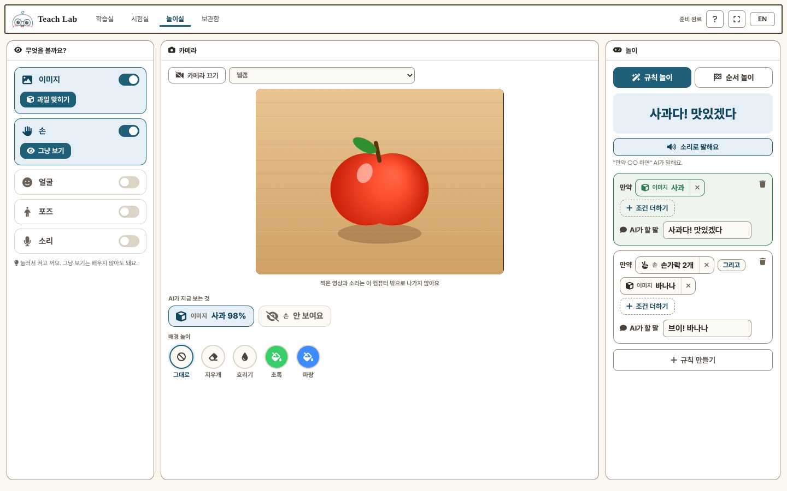
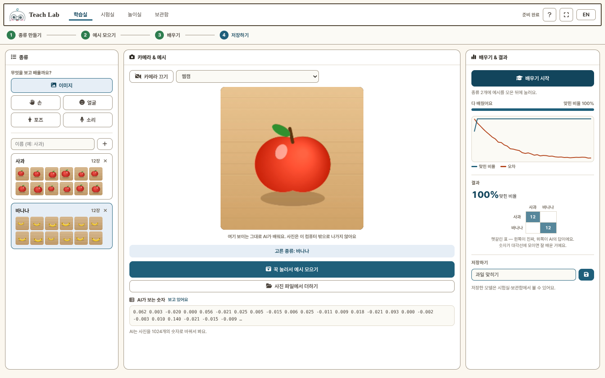
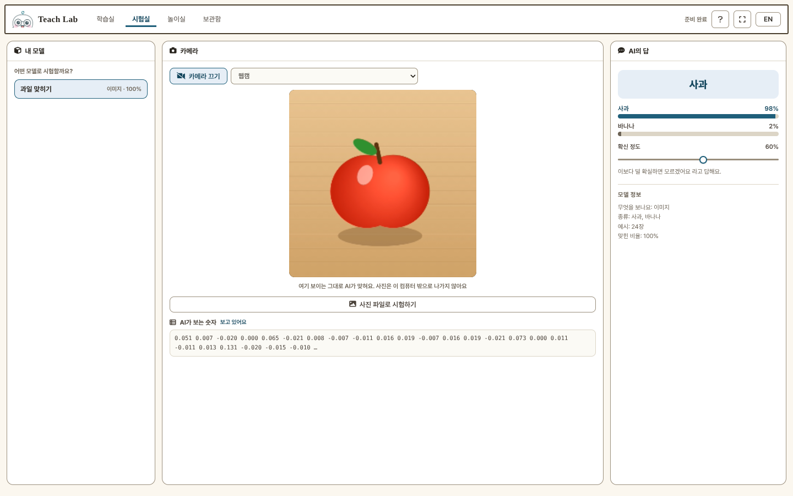
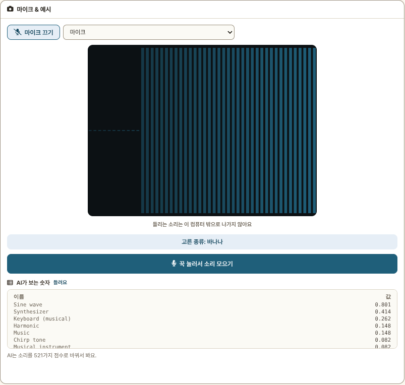
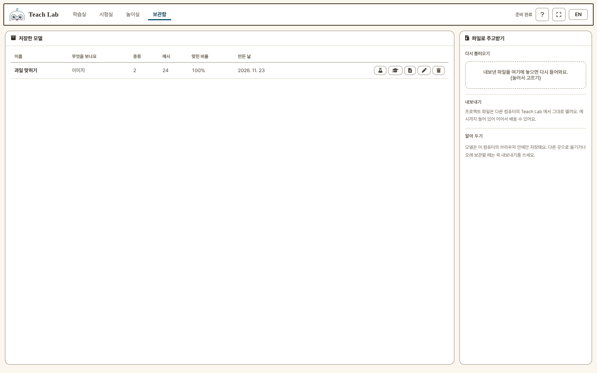

  

<h1 align="center">Teach Lab</h1>

<b>웹캠과 마이크로 보여 주며 AI를 가르치고, 가르친 AI로 놀아요.</b>

  <a href="https://themakerrobot.github.io/teach-lab/"><b>▶ 바로 쓰기</b></a> ·
  <a href="docs/MANUAL.md">사용 설명서</a> ·
  <a href="https://github.com/themakerrobot/teach-lab/releases/latest">Windows 용 내려받기</a>

  
  
  

Teach Lab 은 초등학생과 수업을 위한 **Teachable Machine 스타일** 웹앱입니다.
설치도 가입도 없이 크롬·엣지에서 바로 열립니다. 사진·소리는 **컴퓨터 밖으로
나가지 않고**, 학습도 브라우저 안에서 몇 초 만에 끝납니다.

가르치는 데서 끝나지 않아요. **놀이실**에서는 가르친 것과 AI가 이미 아는 것을 엮어
"만약 사과를 보여 주면 *사과다!* 라고 말해" 같은 규칙을 만들고, AI가 소리 내어 대답합니다.

## 네 개의 방

| 방 | 하는 일 |
|---|---|
| **학습실** | 종류를 만들고, 예시를 모으고, 몇 초 만에 가르쳐요 |
| **시험실** | 가르친 AI 하나를 골라 잘 맞히는지 봐요 |
| **놀이실** | 그냥 보기 · 규칙 놀이 · 순서 놀이 · 배경 놀이. AI가 소리 내어 말해요 |
| **보관함** | 이름 바꾸기 · 이어서 배우기 · 파일로 내보내고 불러오기 |

## 이런 것을 가르칠 수 있어요

| 고르기 | 예를 들면 | AI가 보는 것 |
|---|---|---|
| **이미지** | 사과 / 바나나, 내 카드, 그린 그림 | 사진 그대로 (1024개 숫자) |
| **손** | 가위 / 바위 / 보, 숫자 손가락 | 손가락 관절 21점 (한 손 · 두 손) |
| **얼굴** | 웃기 / 놀라기 / 입 벌리기 | 표정 점수 52개 |
| **포즈** | 만세 / 팔짱 / 한 발 서기 | 몸의 관절 (상반신 · 전신) |
| **소리** | 박수 / 휘파람 / "안녕" | 소리 점수 521개 |

## 3분 만에 해 보기

1. [사이트를 엽니다](https://themakerrobot.github.io/teach-lab/). 카메라 권한을 물어보면 **허용**.
2. 맞히고 싶은 것마다 이름을 적고 **+** 를 누릅니다. 예: `사과`, `바나나`.
3. 종류를 하나 고른 뒤, 카메라에 보여 주면서 **꾹 눌러서 예시 모으기**를 누르고 있으면
   초당 10장씩 모입니다. 종류마다 20~40장이면 충분해요.
4. **배우기 시작**. 몇 초 뒤 맞힌 비율과 헷갈린 표가 나옵니다.
5. 이름을 붙여 **저장**하고, **시험실**이나 **놀이실**에서 보여 주세요.

처음 들어가면 파이보가 말풍선으로 화면을 안내합니다. 헤더의 **?** 로 다시 볼 수 있고,
**EN** 을 누르면 화면 전체가 영어로 바뀝니다.

## 시험실 — 잘 배웠는지 보기

종류별 확률이 막대로 나오고, **확신 정도**보다 덜 확실하면 *"모르겠어요"* 라고 답합니다.
이미지 모델은 사진 파일 하나로도 시험해 볼 수 있어요.

## 놀이실 — 가르친 AI로 놀기

왼쪽에서 볼 것을 눌러 켭니다. 소스마다 두 가지 중에 골라요.

- **그냥 보기** — 가르치지 않아도 AI가 이미 아는 것. 손가락 개수, 얼굴 방향, 입 벌리기·웃기,
  손 들기, 박수·휘파람·말소리를 바로 알아봐요.
- **내 모델** — 학습실에서 가르친 모델.

여러 개를 한꺼번에 켤 수 있어서, 가르친 것과 그냥 아는 것을 섞어 쓸 수 있습니다.

**규칙 놀이**는 "만약 ○○ 하면 AI가 △△ 라고 말해요" 를 만듭니다. 조건은 큰 칩에서 고르고,
**지금 맞는 것은 초록으로 켜져서** 직접 해 보면서 고를 수 있어요. 조건은 **그리고 / 또는** 으로 엮습니다.

**순서 놀이**는 "주먹 → 손바닥 → 박수" 처럼 동작을 순서대로 하면 한 칸씩 내려가고,
끝까지 가면 AI가 "성공!" 이라고 외칩니다.

**배경 놀이**는 AI가 사람과 배경을 나눠 배경을 지우거나, 흐리거나, 초록·파랑으로 바꿉니다.

> AI의 목소리는 **이 기기 안에 있는 목소리**만 씁니다. 읽을 문장도 밖으로 나가지 않아요.
> 기기에 한국어 목소리가 없으면 화면에만 답이 나옵니다.

## 소리도 가르쳐요

소리를 고르면 카메라 대신 마이크가 켜집니다. 박수·휘파람·말소리처럼 **서로 다른
소리**일수록 잘 갈립니다. 조용한 상태도 종류 하나로 만들어 두면
"아무 소리 없음"을 구분할 수 있어요.

## 보관함 — 지키고, 나눠 주기

저장한 모델은 여기 모입니다. 이름을 바꾸고, **이어서 배우기**로 예시를 더 모아 다시 학습하고,
**프로젝트 파일**(`.teachlab.zip`)로 내보낼 수 있어요. 모델과 예시, 썸네일이 함께 들어 있어서
다른 컴퓨터의 Teach Lab 에 끌어다 놓으면 그대로 돌아옵니다.

> 모델은 **이 컴퓨터의 브라우저 안에만** 저장됩니다.
> 재부팅하면 초기화되는 교실 PC 에서는 꼭 내보내기를 해 두세요.

## 인터넷 없이 쓰기

- **Windows**: [Releases](https://github.com/themakerrobot/teach-lab/releases/latest) 에서 `TeachLab.exe` 를 받아
  더블클릭하면 브라우저가 열립니다. 사이트 전체가 들어 있어서 (약 75MB) 오프라인 교실에서도 됩니다.
- **태블릿 · 폰**: 크롬에서 한 번 연 뒤 "홈 화면에 추가"하면 앱처럼 열립니다.
- **웹**: 한 번 받아 둔 뒤에는 브라우저 캐시에서 열립니다. 처음 열 때는 엔진과 모델을 받느라
  학생 한 명당 수십 MB 가 내려가니, 교실에서는 미리 한 번씩 열어 두면 좋아요.

## 자주 묻는 것

| 궁금한 것 | 답 |
|---|---|
| 사진이 어디로 가나요? | 어디로도 안 갑니다. 서버가 없고 전부 브라우저 안에서 돕니다. 저장하는 것도 사진이 아니라 숫자(특징)와 작은 썸네일뿐이에요 |
| 어떤 브라우저에서 되나요? | PC · 태블릿 · 폰의 크롬 · 엣지. 사파리는 일부 기능이 느릴 수 있어요 |
| 잘 못 맞혀요 | 예시를 더 모으고, 배경·밝기·각도를 조금씩 바꿔 가며 모으세요. 종류마다 예시 수를 비슷하게 맞추면 좋아요 |
| 아무거나 다 맞힌다고 해요 | 시험실의 **확신 정도**를 올리거나, "아무것도 없음" 종류를 하나 만드세요. 놀이실도 이 값을 같이 써요 |
| AI가 말을 안 해요 | 놀이실의 소리 버튼과 컴퓨터 소리를 확인하세요. "쓸 수 있는 목소리가 없어요" 라고 나오면 그 기기에 한국어 목소리가 없는 거예요 |
| 저장한 모델이 사라졌어요 | 브라우저 기록을 지우면 같이 지워집니다. 보관함에서 프로젝트 파일로 내보내 두세요 |
| Teachable Machine 과 뭐가 다른가요? | 화면과 문구가 어린이용이고, 손·얼굴·포즈·소리를 MediaPipe 로 봅니다. 가르친 뒤 놀이실에서 규칙·순서 놀이로 엮어 쓰고, AI가 소리 내어 대답해요. 이미지는 TM 과 같은 가운데 정사각형·거울 방식이라 보이는 대로 배워요 |

더 자세한 사용법은 **[사용 설명서](docs/MANUAL.md)** 에 그림으로 정리해 두었어요.

## 버전

웹앱과 `TeachLab.exe` 는 [Releases](https://github.com/themakerrobot/teach-lab/releases) 의 최신 `v*` 를 봅니다.
사이트는 늘 최신이고, exe 는 Release 에 첨부됩니다. 바뀐 내용은 [CHANGELOG.md](CHANGELOG.md) 에 있습니다.

> 예전에 있던 파이썬 내보내기와 PyPI `teachlab` 패키지는 v0.2.0 에서 걷어냈습니다.
> 이미 올린 `teachlab` 0.4.0 까지는 PyPI 에 그대로 남아 있지만 더 고치지 않습니다.

## 함께 보기

- [themaker-ui](https://github.com/themakerrobot/themaker-ui) — 자매 서비스들이 함께 쓰는 디자인 킷
- 개발 · 배포 · 릴리스 절차는 [DEVELOP.md](DEVELOP.md) 에 있습니다

## 라이선스

[MIT](LICENSE)
