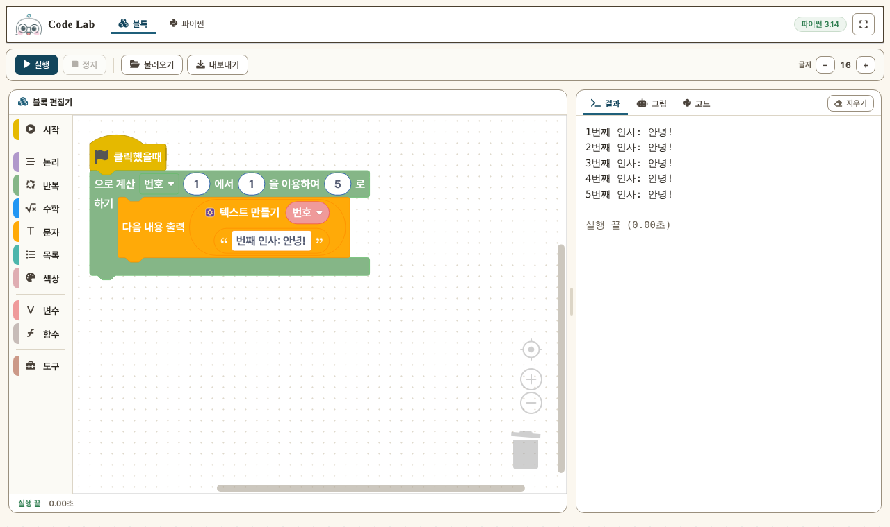
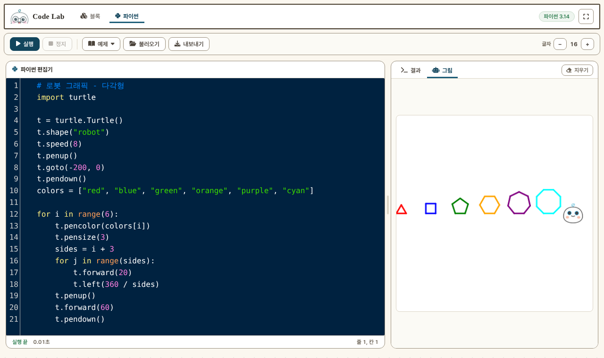

# Code Lab

**블록과 파이썬으로 코딩하고, 브라우저에서 바로 실행해요.**

설치도 가입도 없습니다. 페이지를 열면 바로 코딩할 수 있고, 작업은 그 브라우저에 자동으로 저장됩니다.
파이썬은 브라우저 안에서 **진짜 파이썬 3.14**([Pyodide](https://pyodide.org/))로 돌아갑니다 —
코드가 서버로 가지 않고, 한 번 열면 **인터넷이 끊겨도** 다시 열립니다.

**바로 쓰기 → https://themakerrobot.github.io/code-lab/** (시험판 · `main`)



## 한눈에 보기

| | **블록** | **파이썬** |
|---|---|---|
| 하는 일 | 끌어다 붙여서 프로그램 만들기 | 파이썬 코드 직접 쓰기 |
| 실행 | 블록이 만든 파이썬을 브라우저에서 실행 | 쓴 코드를 브라우저에서 실행 |
| 보조 | **코드** 탭에서 만들어진 파이썬 보기 → **파이썬으로 고치기** | 예제 · 오류 난 줄 표시 |

- 헤더의 **블록 / 파이썬** 탭으로 편집 방식을 바꿉니다.
- **실행** `Ctrl+Enter` · **정지** `Esc` · **바로 저장** `Ctrl+S`
- 결과는 오른쪽 **결과** 탭(글자)과 **그림** 탭(turtle)에 나옵니다.

## 블록으로 코딩하기

1. 헤더에서 **블록**을 누릅니다.
2. 왼쪽 분류에서 블록을 끌어다 **시작(깃발) 블록 아래에** 붙입니다.
   시작 블록에 붙지 않은 블록은 흐리게 보이고 실행되지 않아요. 시작 블록은 하나만 둘 수 있어요.
3. **실행**을 누릅니다.

오른쪽 **코드** 탭에서 블록이 만든 파이썬을 볼 수 있어요.
**파이썬으로 고치기**를 누르면 그 코드가 파이썬 편집기로 옮겨지고, **.py** 로 받을 수도 있어요.
변수 이름을 한글로 지어도 파이썬 코드에 한글 그대로 들어가고, 그대로 실행됩니다.

| 분류 | 무엇을 하나요 |
|---|---|
| 시작 | 깃발 블록 — 프로그램의 시작 |
| 논리 · 반복 · 수학 · 문자 · 목록 · 색상 | 파이썬 기본 |
| 변수 · 함수 | 이름 짓기, 함수 만들기 |
| 도구 | 기다리기 · 시간 · 사전 · 형 변환 · 파일 확인 |

## 파이썬으로 코딩하기



1. 헤더에서 **파이썬**을 누릅니다.
2. 코드를 쓰거나 **예제**에서 하나를 고릅니다.
3. **실행**을 누릅니다.

- `input()` 을 쓰면 결과 탭 아래에 입력 칸이 나옵니다. 입력하고 Enter.
- `import turtle` 이 있으면 **그림** 탭이 열립니다. `t.shape("robot")` 으로 파이보 모양 거북이를 쓸 수 있어요.
- 오류가 나면 **몇 번째 줄 · 무슨 뜻**을 쉬운 말로 먼저 알려 주고, 편집기에서 그 줄을 빨갛게 짚어 줍니다.
  그 아래에 원래 파이썬 오류 메시지가 나옵니다.
- **정지**(`Esc`)는 무한 반복도 바로 멈춥니다. 멈춘 뒤 1~2초 동안 파이썬을 다시 준비해요.
- 출력이 아주 많으면 앞부분은 자동으로 지우고 최근 것만 남깁니다 (화면이 느려지지 않게).

### 예제

| 예제 | 배우는 것 |
|---|---|
| 인사하기 | `print` |
| 입력 받기 | `input` · 형 변환 |
| 구구단 | 이중 `for` 문 |
| 함수 만들기 | `def` · 기본값 인자 |
| 리스트 | 인덱스 · 리스트 컴프리헨션 |
| 한글 이름 쓰기 | 한글 변수 · 함수 이름 |
| 숫자 표 (numpy) | `numpy` 배열 · 평균 · 최댓값 |
| 로봇 그림 — 도형 / 나선 | `turtle` |
| 숫자 맞추기 게임 | `while` · `random` · `break` |

예제를 추가하려면 `lib/examples.js` 에 항목 하나를 더하면 됩니다 (`turtle: true` 면 그림 탭이 열려요).

### 쓸 수 있는 것

- **파이썬 표준 라이브러리** 대부분 (`random`, `math`, `time`, `datetime`, `json`, `re`, `collections` …)
- **numpy, pandas 같은 과학 패키지** — `import` 하면 처음 한 번 인터넷(jsDelivr CDN)에서 받아 오고,
  그 뒤엔 브라우저에 담아 두어 오프라인에서도 됩니다. 받을 수 있는 목록은 `vendor/pyodide/pyodide-lock.json`.
- **turtle** — Code Lab 이 브라우저용으로 따로 만든 모듈입니다 (`lib/turtle.py`).
  이동 · 회전 · 펜 · 색 · 채우기 · `circle` · `dot` · `write` · `stamp` · `shape` · `speed` · `tracer` ·
  `bgcolor` · `setup` · `colormode`, `turtle.forward(100)` 같은 모듈 함수까지 됩니다.

### 아직 안 되는 것

- turtle 의 **키보드 · 마우스 이벤트** (`onkey`, `onclick`, `ontimer`) — 부르면 "아직 지원하지 않아요" 라고 알려 줍니다.
- `tkinter` 같은 창(GUI), 실제 파일 시스템 · 네트워크 소켓.
- `matplotlib` 그래프를 화면에 보이기 (그림을 띄울 곳이 아직 없어요).

## 저장 · 불러오기 · 내보내기

- **자동 저장**: 블록과 파이썬 코드가 이 브라우저에 따로 저장됩니다. 페이지를 다시 열면 그대로 있어요.
  편집 방식 · 글자 크기도 기억합니다.
- **내보내기**: 블록 모드는 `blocks.json`, 파이썬 모드는 `code.py` 로 받습니다.
- **불러오기**: `.json` 은 블록 편집기로, `.py` · `.txt` 는 파이썬 편집기로 엽니다.
  지금은 없는 블록(예전 로봇 전용 블록 등)이 든 `.json` 은 그 블록만 빼고 엽니다.

자동 저장은 그 컴퓨터의 그 브라우저에만 남습니다. 시크릿 창, 브라우저 기록 삭제,
재부팅하면 초기화되는 교실 PC 에서는 사라지니 **내보내기**로 파일을 챙겨 두세요.

## 오프라인 · 처음 열 때

- 처음 열면 파이썬(약 13MB)을 받아 와서 1~3초쯤 걸립니다. 헤더 배지가 **파이썬 3.14** 로 바뀌면 준비 끝.
- 한 번 열고 나면 페이지 · 파이썬 · 블록이 브라우저에 담겨, **인터넷 없이** 다시 열고 실행할 수 있어요.
  홈 화면에 추가(앱 설치)도 됩니다.
- 새 버전을 올린 뒤에는 **두 번째로 열 때** 새 버전이 보입니다 (처음엔 담아 둔 것을 보여 주고 뒤에서 받아요).
- 크롬 · 엣지 최신판에서 확인했습니다. 사파리 · 파이어폭스는 **확인 필요** (특히 `input()` 입력 칸).

## 개발

### 로컬에서 띄우기

빌드 과정이 없는 정적 페이지입니다.

```bash
python3 -m http.server 8080      # 그리고 http://localhost:8080/
```

`file://` 로 직접 열면 파이썬 워커 · 서비스 워커가 동작하지 않습니다. 꼭 서버로 띄워 주세요.

### 구조

```
화면 (index.html · lib/app.js)
  ├─ 블록 편집기 (Blockly) ─┐
  ├─ 파이썬 편집기 (CodeMirror) ┴→ 파이썬 코드
  │                               │ run
  ├─ lib/py-runner.js ────────────┴─→ lib/py-worker.js (Web Worker · Pyodide)
  │     정지 = 워커를 끝내고 새로 띄움        │ print → 결과 탭
  │                                         │ turtle → lib/turtle-canvas.js
  └─ sw.js (서비스 워커)  ←── input() 동기 요청 ┘
        · 오프라인 캐시
        · input(): 워커의 요청을 붙잡고 있다가 화면이 준 답으로 응답
```

- **왜 워커인가**: 파이썬이 오래 돌아도 화면이 멈추지 않고, 정지를 누르면 워커째 끝내서 무한 반복도 바로 멈춥니다.
  (Pyodide 를 중간에 멈추는 `SharedArrayBuffer` 방식은 서버 응답 헤더를 바꿔야 해서 GitHub Pages 에서 못 씁니다.)
- **왜 input() 이 서비스 워커를 거치나**: 워커 안의 파이썬은 답을 "기다리며 멈춰" 있어야 합니다.
  워커가 동기 요청(`__codelab__/input`)을 보내면 서비스 워커가 그 요청을 붙잡고 있다가,
  화면에서 입력이 오면 그 글자로 응답합니다. 서비스 워커가 없는 환경에서는 `input()` 이 빈 글자를 받습니다.

### 파일 구성

```
index.html
manifest.webmanifest     앱 설치 정보
sw.js                    서비스 워커 (오프라인 캐시 · input 다리) — 새 버전이면 VERSION 을 올린다
css/
  themaker-ui.css        디자인 킷 복사본 (고치지 말 것 — 아래 "디자인 킷")
  app.css                Code Lab 전용 스타일
  all.min.css            Font Awesome 6.2
lib/
  app.js                 화면 · 편집기 · 실행 흐름 · 결과 창
  py-runner.js           파이썬 워커 띄우기 · 정지 · input 연결
  py-worker.js           Pyodide 실행 (Web Worker, ES 모듈)
  turtle.py              브라우저용 turtle 모듈 (파이썬)
  turtle-canvas.js       turtle 그림 그리기 (캔버스)
  examples.js            파이썬 예제
blocks/
  customblock.js           시작 · 도구 블록 모양
  customblock_callback.js  블록 → 파이썬 코드
  customblock_toolbox.js   분류(툴박스) 구성
  disable-top-blocks.js    시작 블록에 붙지 않은 블록 비활성화
  svg/                     블록 아이콘
vendor/
  pyodide/            Pyodide 314.0.8 핵심 파일 (Python 3.14)
  blockly/            Blockly + 한국어 메시지(ko.js) + media
  codemirror/         CodeMirror 5 + python 모드 + cobalt 테마
assets/fonts/         Pretendard (셀프호스팅)
assets/img/           로고 · 파비콘 · turtle 로봇 그림
webfonts/             Font Awesome 글꼴
docs/                 README 화면 캡처
```

### 블록 추가하기

1. `blocks/customblock.js` — 블록 모양 (`Blockly.defineBlocksWithJsonArray`). 아이콘은 `blocks/svg/`.
2. `blocks/customblock_callback.js` — `Blockly.Python.forBlock['블록이름']` 으로 파이썬 코드 생성.
   import 는 `Blockly.Python.definitions_` 에 넣으면 한 번만 들어갑니다.
   값 칸이 비었을 때도 문법이 깨지지 않게 기본값을 넣어 주세요 (`|| 'None'`).
3. `blocks/customblock_toolbox.js` — 원하는 분류의 `contents` 에 블록 추가.
4. `vendor/blockly/ko.js` — 블록 문구 `Blockly.Msg["…"]` 추가.
5. 새 파일을 만들었으면 `sw.js` 의 `PRECACHE` 에도 넣습니다 (CI 가 빠진 파일을 잡아 줍니다).

### Pyodide 올리기

1. `npm pack pyodide@<버전>` 으로 받아서 `pyodide.mjs` · `pyodide.asm.mjs` · `pyodide.asm.wasm` ·
   `python_stdlib.zip` · `pyodide-lock.json` 을 `vendor/pyodide/` 에 덮어씁니다.
2. `lib/py-worker.js` 의 `CDN` 주소 버전을 같은 번호로 바꿉니다 (추가 패키지를 받는 곳).
3. `sw.js` 의 `VERSION` 을 올립니다.

### 배포 (자매 서비스 sense-lab · teach-lab 과 같은 방식)

| 브랜치 | 어디로 | 용도 |
|---|---|---|
| `main` | GitHub Pages — https://themakerrobot.github.io/code-lab/ | 시험 |
| `release` | Cloudflare Workers (자동 배포) | 학생이 쓰는 주소 |

1. `main` 에 작업을 머지하면 1분 안팎으로 GitHub Pages 에 올라갑니다 (`.nojekyll` 로 Jekyll 처리 없음). 여기서 확인합니다.
2. 통과하면 `release` 에 같은 커밋을 푸시합니다 → Cloudflare 가 자동으로 배포합니다.
   ```bash
   git push origin main:release
   ```
3. 화면에 보이는 파일을 바꿨으면 `sw.js` 의 `VERSION` 을 올려 둡니다 — 학생 브라우저의 옛 캐시를 지웁니다.

- Cloudflare 는 Workers 정적 배포입니다: `wrangler.toml` + `.assetsignore` + `_headers` (워커 코드 없음 — 자산만 서빙).
  수동으로 올릴 때는 `npx wrangler deploy`.
- `_headers` 는 `.wasm` · `.task` 같은 파일 형식과, `sw.js` 를 늘 새로 받게 하는 설정을 담습니다.
- 파일 하나가 25MiB 를 넘으면 Cloudflare 가 받지 않습니다 (지금 가장 큰 것은 Pyodide 의 약 9.6MB).
- 모든 경로가 상대경로라 하위 경로 배포에서도 동작합니다.

**처음 한 번만 (Cloudflare 대시보드 — 메뉴 이름은 바뀔 수 있어요)**: Workers & Pages → Create → Import a repository →
`themakerrobot/code-lab` 선택 → 프로덕션 브랜치를 **`release`** 로, 빌드 명령은 비우고
배포 명령은 `npx wrangler deploy` 로 둡니다. 그 뒤로는 `release` 에 푸시할 때마다 자동으로 올라갑니다.

### CI

`.github/workflows/ci.yml`

- **문법** — `lib/*.js`, `blocks/*.js`, `sw.js` 를 `node --check`, `lib/turtle.py` 를 `py_compile`
- **캐시 목록** — `sw.js` 의 `PRECACHE` 파일이 모두 있는지
- **디자인 킷** — `css/themaker-ui.css` 가 킷 원본(태그 고정)과 같은지

### 앞으로 붙일 수 있는 것

- **보드 연결** — Web Serial 로 ESP32-S3 같은 보드(MicroPython)에 코드를 보내고 결과 받기
- **브라우저 센서** — 웹캠 · 마이크를 블록/파이썬에서 쓰기 (sense-lab 처럼 기기 없이 AI · 센서 체험)
- turtle 키보드 · 마우스 이벤트, matplotlib 그림 보이기, 영어 화면

## 디자인 킷

화면은 공용 디자인 킷 [themaker-ui](https://github.com/themakerrobot/themaker-ui) 의 "학습지" 테마를 씁니다.
sense-lab · teach-lab 과 같은 헤더 · 버튼 · 패널 · 배지 · 토스트입니다.

- `css/themaker-ui.css` 는 킷 **v1.0.0** 의 복사본입니다. 여기서 고치지 않습니다.
  고칠 것이 있으면 themaker-ui 를 고치고 태그를 올린 뒤 다시 복사하고, CI 의 `KIT=` 번호를 바꿉니다.
- Code Lab 에만 있는 것(도구 줄 · 편집기 · 결과 탭 · 입력 줄 · turtle)은 `css/app.css` 에 둡니다. 색은 킷 토큰만 씁니다.
- 예외: 코드 편집기 안쪽(cobalt 어두운 테마)과 블록 색은 눈에 익은 기존 색을 유지합니다.

## 라이선스

Code Lab 코드는 [MIT](LICENSE) 입니다.

### 포함된 오픈소스

| 구성 요소 | 라이선스 |
|---|---|
| [Pyodide](https://github.com/pyodide/pyodide) (CPython 포함) | MPL 2.0 (CPython 은 PSF License) |
| [Blockly](https://github.com/google/blockly) | Apache 2.0 |
| [CodeMirror 5](https://codemirror.net/5/) | MIT |
| [Font Awesome Free 6.2](https://fontawesome.com/) | 아이콘 CC BY 4.0 · 글꼴 SIL OFL 1.1 · 코드 MIT |
| [Pretendard](https://github.com/orioncactus/pretendard) | SIL OFL 1.1 |

각 구성 요소는 자기 라이선스를 따릅니다 (`vendor/`, `assets/fonts/`, `css/all.min.css`, `webfonts/`).
