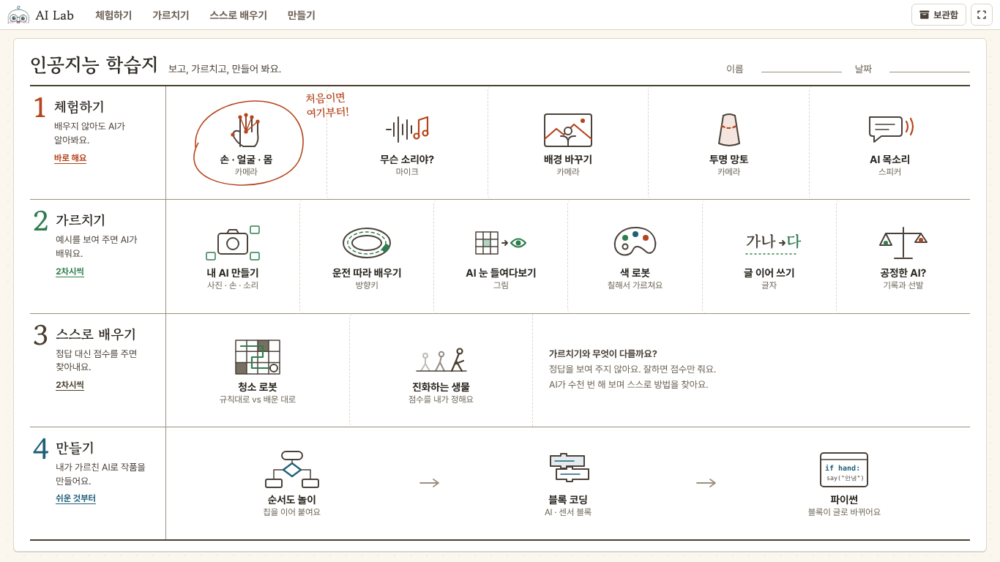
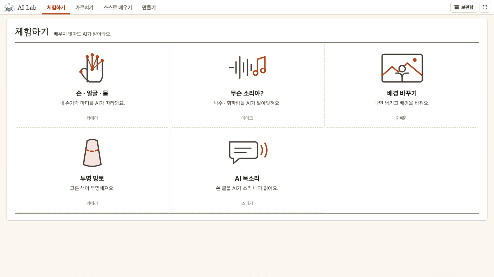
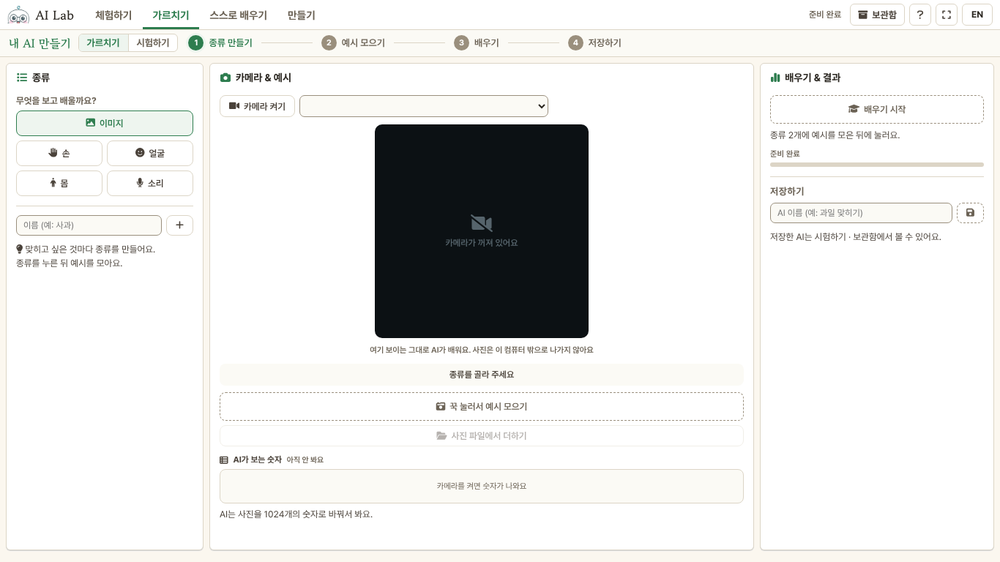
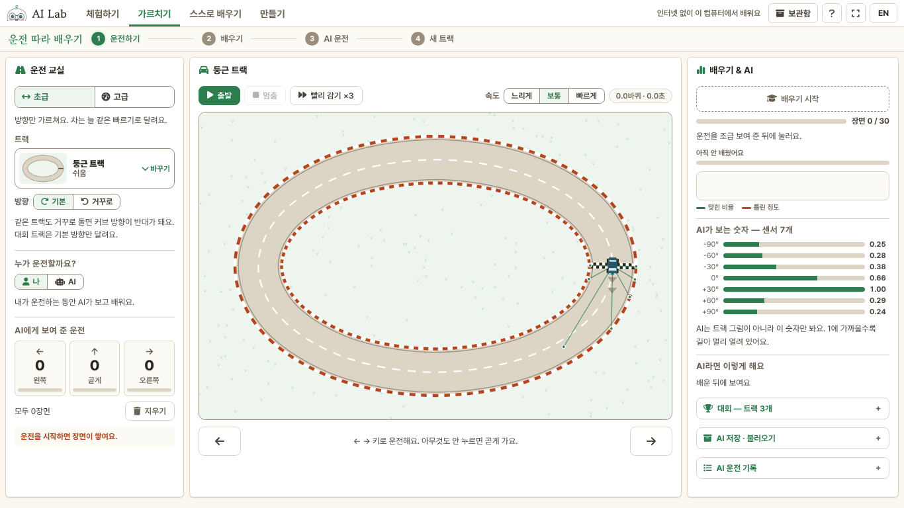
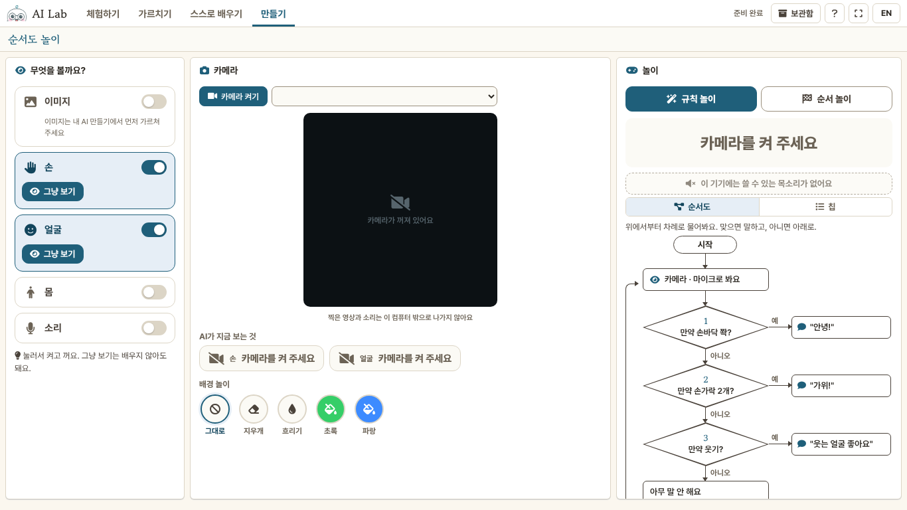
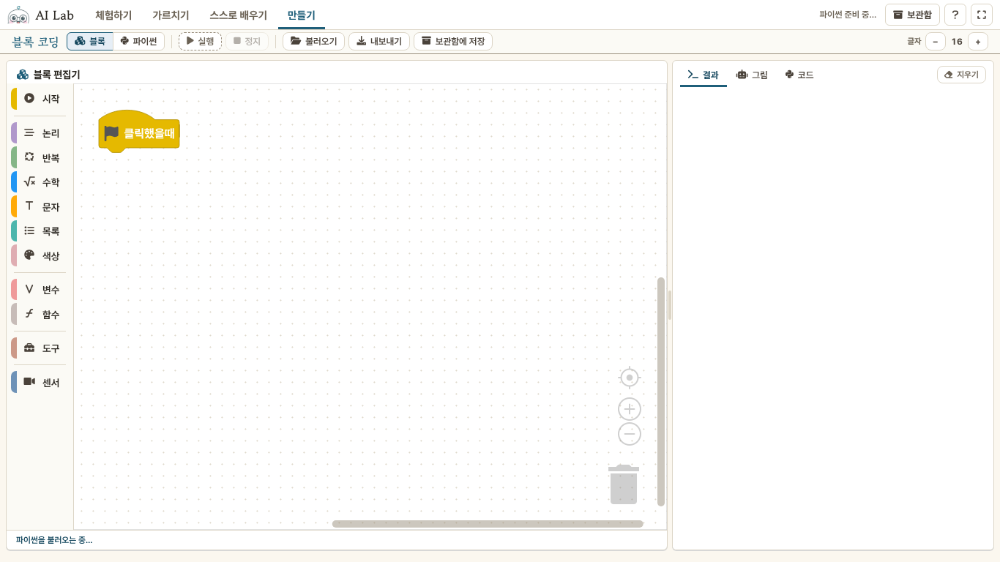
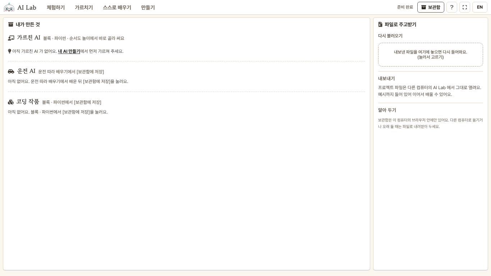

# AI Lab 사용 가이드 (선생님용)

**AI Lab** 은 초등학생이 인공지능을 **보고, 가르치고, 만들어 보는** 웹 도구입니다.
주소 하나로 열리고, 설치 · 가입 · 요금이 없습니다.

**바로 열기 → https://themakerrobot.github.io/ai-lab/**

---

## 목차

1. [수업 전에 준비할 것](#1-수업-전에-준비할-것)
2. [화면 읽는 법](#2-화면-읽는-법)
3. [체험하기 — 배우지 않아도 AI 가 알아봐요](#3-체험하기)
4. [가르치기 — 예시를 보여 주면 AI 가 배워요](#4-가르치기)
5. [스스로 배우기 — 점수를 주면 AI 가 찾아내요](#5-스스로-배우기)
6. [만들기 — 내가 가르친 AI 로 작품을](#6-만들기)
7. [보관함 — 만든 것 모으기 · 옮기기](#7-보관함)
8. [수업 흐름 예시](#8-수업-흐름-예시)
9. [안 될 때](#9-안-될-때)

---

## 1. 수업 전에 준비할 것

| 항목 | 내용 |
|---|---|
| 브라우저 | **크롬 · 엣지** (최신). 아이패드는 iPadOS 16.4 이상 |
| 인터넷 | **처음 열 때만** 필요해요. 한 번 연 활동은 다음부터 빨리 열려요 |
| 카메라 · 마이크 | 손 · 얼굴 · 몸 · 소리를 쓰는 활동에만. 없어도 되는 활동이 대부분이에요 |
| 스피커 | AI 목소리 · 말하기 블록을 쓸 때. 기기 안 목소리가 있어야 해요 ([9장](#9-안-될-때)) |
| 모둠 | 2~3명이 PC 한 대 — 조작 · 기록 · 발표를 돌아가며 |

수업 전 확인 (5분)

- [ ] 학생 PC 에서 주소가 열리는지
- [ ] 카메라를 쓰는 날이면: **체험하기 → 손 · 얼굴 · 몸** 을 열고 **카메라 켜기** → 브라우저가 물으면 **허용**
- [ ] 소리를 쓰는 날이면: **체험하기 → AI 목소리** 를 열고 **읽어 줘요** 를 눌러 소리가 나는지
- [ ] 처음 여는 활동은 파일을 받느라 몇 초~수십 초 걸려요 (손 인식 약 20MB · 파이썬 약 13MB). 수업 전에 한 번 열어 두면 빨라요

> **개인정보** — 사진 · 영상 · 소리 · 글은 **학생 기기 밖으로 나가지 않아요.** 학습과 계산이 모두 브라우저 안에서 이뤄지고, 서버로 보내는 데이터가 없어요. 목소리도 기기 안 목소리만 써요.

---

## 2. 화면 읽는 법

### 상단바 — 어느 화면에서나 같아요

| 자리 | 하는 일 |
|---|---|
| **파이보 · AI Lab** | 누르면 첫 화면(학습지)으로 |
| **체험하기 · 가르치기 · 스스로 배우기 · 만들기** | 메뉴 넷. 지금 메뉴는 색 밑줄로 불이 켜져요 (빨강 · 초록 · 갈색 · 남색) |
| 상태 글 | 예: "인터넷 없이 이 컴퓨터에서 배워요", "파이썬 준비 중…" |
| **보관함** | 가르친 AI · 운전 AI · 코딩 작품을 모아 보는 곳 |
| **?** | 그 화면의 안내(파이보 말풍선 · 도움말)를 다시 봐요 |
| **EN / 한** | 영어 화면 ↔ 한국어 화면 |
| ⛶ | 전체화면 |

화면을 아래로 내려도 상단바는 맨 위에 남아요.

### 첫 화면 · 메뉴 화면

- **첫 화면** 은 학습지 한 장이에요. 1 체험하기 → 2 가르치기 → 3 스스로 배우기 → 4 만들기 순서로 놓여 있고, 그림을 누르면 그 활동이 열려요. 빨간 펜 **"처음이면 여기부터!"** 가 첫 활동을 짚어요.
- **메뉴 화면** (상단바 메뉴를 누르면) 은 그 메뉴의 활동 카드를 한 줄 설명과 함께 보여 줘요.

### 활동 화면

- 상단바 아래 줄 맨 앞에 **활동 이름**, 옆에 **단계(1 · 2 · 3 …)** 가 있어요. 지금 단계에 불이 켜져요. 활동 이름을 누르면 메뉴 화면으로 돌아가요.
- 화면은 **왼쪽(준비) · 가운데(보기 · 하기) · 오른쪽(배우기 · 결과)** 세 칸이에요.
- 아직 누를 수 없는 주 단추는 **점선** 으로 보여요 (예: 장면이 모자랄 때의 "배우기 시작").
- 빨간 손글씨 메모는 지금 해 볼 것을 알려 주는 안내예요.

---

## 3. 체험하기

**배우지 않아도 AI 가 알아보는 것** 을 먼저 경험해요. 수업 시작 5~10분 놀이로 좋아요.

| 활동 | 하는 것 | 준비물 |
|---|---|---|
| **손 · 얼굴 · 몸** | 카메라 앞의 손가락 마디 · 얼굴 · 몸을 AI 가 점과 선으로 따라와요. 왼쪽 카드로 손 · 얼굴 · 몸을 켜고 꺼요 | 카메라 |
| **무슨 소리야?** | 박수 · 휘파람 · 말소리를 AI 가 알아맞혀요 | 마이크 |
| **배경 바꾸기** | 사람만 남기고 배경을 지우거나 흐리게 · 색으로 바꿔요 | 카메라 |
| **투명 망토** | AI 에게 미리 칠해 둔 상태로 열려, 망토가 바로 사라져요. 화분 · 셔츠처럼 비슷한 색은 AI 가 헷갈려요 → **칠하기** 로 더 가르쳐 보기 | 없음 (예시 사진) |
| **AI 목소리** | 쓴 글을 AI 가 읽어요. 목소리 · 빠르기 · 높낮이를 바꾸고, 읽는 낱말에 밑줄이 따라가요 | 스피커 |

**발문 예시** — "AI 는 손을 어떻게 알아볼까?", "왜 화분도 사라졌을까?", "숫자 '3:30' 은 어떻게 읽을까?"

---

## 4. 가르치기

**예시를 보여 주면 AI 가 배워요 (지도학습).** 활동마다 2차시 안팎이에요.

### 내 AI 만들기 (사진 · 손 · 얼굴 · 몸 · 소리)

1. **종류 만들기** — 왼쪽에서 무엇을 볼지 고르고(사진 · 손 · 얼굴 · 몸 · 소리), 맞힐 것마다 종류를 만들어요 (예: 가위 · 바위 · 보)
2. **예시 모으기** — 종류를 누르고 가운데 **꾹 눌러서 예시 모으기**. 종류마다 비슷한 수로, 각도 · 거리를 바꿔 가며
3. **배우기** — 오른쪽 **배우기 시작**. 맞힌 비율이 나와요
4. **저장하기** — 이름을 붙여 저장하면 **보관함** 에 들어가요

- 활동 이름 옆 **[가르치기 | 시험하기]** 로 바로 시험해 볼 수 있어요. 확신이 모자라면 "잘 모르겠어요" 라고 답해요.
- 저장한 AI 는 **만들기(순서도 놀이 · 블록 · 파이썬)** 에서 바로 골라 써요 — 파일을 옮길 필요가 없어요.

### 운전 따라 배우기

내가 `←` `→` 로 운전하면, 차의 센서 숫자 7개와 내가 고른 방향을 AI 가 따라 배워요 (모방학습).

1. **운전하기** — 처음에는 **느리게**, 구불구불한 트랙에서. 왼쪽 **장면 수 카드** 가 쌓여요
2. **배우기** — 장면이 30개를 넘으면 **배우기 시작** 이 켜져요 (그 전에는 아래 막대가 "장면 n / 30")
3. **AI 운전** — "누가 운전할까요?" 에서 **AI** 로 바꾸고 출발
4. **새 트랙** — 배운 적 없는 트랙에서도 되는지

- 한쪽 커브만 모이면 모자란 칸에 **빨간 펜 동그라미** 와 "오른쪽 커브도 보여 줘요!" 가 떠요 — 데이터 편향 이야기를 하기 좋은 장면이에요.
- **고급** 은 빠르기(가속 · 감속)까지 가르쳐요. 초급을 해 본 뒤에.
- 오른쪽 아래 접는 칸: **대회 — 트랙 3개**(가르친 실력으로 겨루기) · **AI 저장 · 불러오기**(보관함에 저장, 파일로 내려받기) · **AI 운전 기록**

### 그 밖의 가르치기 활동

| 활동 | 단계 | 무엇을 배우나 |
|---|---|---|
| **AI 눈 들여다보기** | 예시 모으기 → 배우기 → 들여다보기 → 속이기 | 그림 보는 신경망을 처음부터 만들고, 필터 · 특징 지도로 AI 가 무엇을 보는지 봐요. **예시 그림 넣기(○ △ ☆)** 로 카메라 없이도 돼요 |
| **색 로봇** | 칠해서 가르치기 → 색 지도 → 로봇 미션 | 색을 칠해 가르치면 AI 가 픽셀마다 골라요. 조명이 바뀌면 틀리고, 그 조명으로 더 가르치면 나아져요 |
| **글 이어 쓰기** | 글 넣기 → 배우기 → 이어 쓰기 → 들여다보기 | 가르친 글을 읽고 다음 글자를 맞히며 글을 이어 써요 (작은 언어모델) |
| **공정한 AI?** | AI 만들기 → 공정한가? → 고치기 | 불공정한 작년 기록으로 배운 AI 가 실력이 같은 세 친구를 어떻게 고르는지 보고, 기록을 고쳐 봐요 |

---

## 5. 스스로 배우기

**정답을 보여 주지 않고, 잘하면 점수만 줘요.** AI 가 수천 번 해 보며 방법을 찾아요 (강화학습 · 진화).

| 활동 | 단계 | 하는 것 |
|---|---|---|
| **청소 로봇** | 규칙 청소기 → 배우는 청소기 → 센서 · 새 방 | 규칙대로 도는 청소기와 스스로 배운 청소기를 겨뤄요. **상과 벌점**(먼지 · 한 걸음 · 벽)을 바꿔 **연습하기** → 시합 |
| **진화하는 생물** | 진화시키기 → 상 바꾸기 → 새 땅 · 돌연변이 | 가상 생물이 세대를 거듭하며 걷는 법을 찾아요. 무엇에 점수를 줄지 내가 정해요 |

**발문 예시** — "벽에 부딪혀도 벌점이 없으면 어떻게 될까?", "멀리 가는 것만 점수로 주면 이상하게 걷지 않을까?"

---

## 6. 만들기

**내가 가르친 AI · 체험한 인식을 재료로 작품을 만들어요.** 쉬운 것부터 세 단계예요.

### ① 순서도 놀이

- 왼쪽에서 볼 것(손 · 얼굴 · 몸 · 소리 · 내 AI)을 켜요.
- 오른쪽 **규칙 놀이** 에서 **규칙 만들기** → "만약 ○○ 하면 → AI 가 할 말". 칩을 골라 붙여요.
- **순서도** 로 보면 같은 규칙이 "시작 → 봐요 → ◇만약 ①? 예 → 말해요 / 아니오 ↓ …" 순서도로 그려져요. 지금 맞는 갈래에 불이 켜져요.
  - 마름모를 누르면 조건을, 말풍선을 누르면 할 말을 바꿔요.
- **순서 놀이** 는 "①을 하고 → ②를 하고 → 성공!" 처럼 차례대로 해내는 놀이예요.
- **목소리** 를 켜면 AI 가 소리 내어 말해요.

### ② 블록 코딩 · ③ 파이썬

- 도구 줄 **[블록 | 파이썬]** 으로 오가요. 블록의 **코드** 탭에서 블록이 바뀐 파이썬을 볼 수 있어요.
- **실행** Ctrl + Enter · **정지** Esc · **바로 저장** Ctrl + S (작업은 자동으로도 저장돼요).
- **센서** 분류: 손가락 수 · 손 위치 · 얼굴 · 머리 위로 든 손 · 소리 크기 · 박수
  - **내 AI**: 가르치기에서 저장한 AI 를 이름으로 골라요 (예: "내 AI [가위바위보] 가 본 것")
  - **AI 목소리로 말하기**: 기기 안 목소리로 읽어요
- 파이썬에서는 `import sensor` 후 `sensor.finger_count()` · `sensor.model("가위바위보")` · `sensor.say("안녕")` 처럼 써요. **예제** 에 "내 AI 로 말하기" 가 있어요.
- **오류가 나면** 결과 칸에 쉬운 설명 한 줄이 먼저 나와요 (예: "4번째 줄: 값이 비어 있어요(None) …", "'（' — 한글 자판의 기호가 섞였는지 …"). 그 아래 원래 오류도 그대로 있어요. 파이썬 화면에서는 틀린 줄에 색이 칠해져요.
- 상단바 **?** 에 단축키 · 센서 · 저장 사용법이 있어요.

---

## 7. 보관함

상단바 **보관함** 에서 내가 만든 것을 한곳에서 봐요.

| 종류 | 어디서 넣나 | 보관함에서 할 수 있는 것 |
|---|---|---|
| **가르친 AI** | 내 AI 만들기 → 저장하기 | 시험하기 · 이어서 배우기 · 파일로 내보내기(.ailab.zip) · 이름 바꾸기 · 지우기 |
| **운전 AI** | 운전 따라 배우기 → 오른쪽 아래 **AI 저장 · 불러오기 → 보관함에 저장** | 열기 · 파일로 · 이름 바꾸기 · 지우기 |
| **코딩 작품** | 블록 · 파이썬 → **보관함에 저장** | 열기 · 파일로 · 이름 바꾸기 · 지우기 |

> 보관함은 **그 컴퓨터의 그 브라우저 안에만** 있어요. 다른 컴퓨터로 옮기거나 오래 둘 때는 **파일로 내려받아** 두세요. 브라우저 기록 · 사이트 데이터를 지우면 보관함도 지워져요.
>
> 옮긴 컴퓨터에서 다시 넣는 곳
> - 가르친 AI(.ailab.zip): 보관함 오른쪽 **다시 불러오기** 칸에 놓기 (블록 · 파이썬의 **불러오기** 로도 돼요)
> - 운전 AI(.json): 운전 따라 배우기 → **AI 저장 · 불러오기** 의 ⬆ 단추
> - 코딩 작품(.json · .py): 블록 · 파이썬의 **불러오기**

---

## 8. 수업 흐름 예시

한 차시 40~45분 기준입니다.

| 차시 | 흐름 |
|---|---|
| 1 | **체험하기**(10분: 손 · 얼굴 · 몸, 무슨 소리야?) → **내 AI 만들기**: 가위 · 바위 · 보 종류 만들기 · 예시 모으기 · 배우기 · 시험하기 · 저장 |
| 2 | **만들기 ① 순서도 놀이**: 저장한 가위바위보 AI 로 "가위면 → '가위!' 라고 말하기" 규칙 3개 → 순서도로 보며 "위에서부터 차례로 묻는다" 이해 |
| 3 | **만들기 ② 블록**: 같은 놀이를 블록으로 — 내 AI 블록 + 조건 + AI 목소리로 말하기 → 코드 탭으로 파이썬 엿보기 |
| 4 | **운전 따라 배우기**: 곧게만 가르치기 vs 골고루 가르치기 비교, 빨간 펜이 짚는 데이터 편향 |
| 5 | **스스로 배우기(청소 로봇)**: 상 · 벌점을 바꾸며 가르치기와 무엇이 다른지 |
| 6 | **공정한 AI?**: 기록이 틀리면 AI 도 틀린다 — 데이터 윤리 |

- 저학년: 체험하기 → 내 AI 만들기 → 순서도 놀이 까지만으로도 충분해요.
- 고학년 · 중학생: 블록 → 파이썬, AI 눈 · 글 이어 쓰기 · 진화로 넓혀요.

---

## 9. 안 될 때

| 증상 | 해 볼 것 |
|---|---|
| 카메라가 안 켜져요 | 주소창 왼쪽 자물쇠 → 카메라 **허용**. 화상회의 등 다른 프로그램이 카메라를 쓰고 있으면 닫기. 노트북 카메라 가리개 확인 |
| 마이크 · 소리 인식이 안 돼요 | 주소창 자물쇠 → 마이크 **허용**, 윈도우 소리 설정의 입력 장치 확인 |
| "이 기기에는 한국어 목소리가 없어요" | **Windows**: 설정 → 시간 및 언어 → 음성 → 한국어 음성 추가. **Mac · 아이패드**: 기본으로 있어요. **크롬북 · 안드로이드**: 기기에 따라 없을 수 있어요 (그래도 화면 글은 그대로 나와요) |
| 처음 열 때 오래 걸려요 | 손 인식 · 파이썬 파일을 처음 한 번 받는 중이에요. 수업 전에 한 번 열어 두세요 |
| 손 · 얼굴 인식이 아예 안 돼요 | 오래된 브라우저일 수 있어요 (크롬 · 엣지 91 미만, iPadOS 16.4 미만). 브라우저를 업데이트하세요 |
| 블록 · 파이썬에서 '내 AI' 가 안 보여요 | 같은 컴퓨터 · 같은 브라우저에서 저장했는지 확인. 블록 센서 분류의 **내 AI 다시 찾기** 를 눌러요 |
| 만든 것이 사라졌어요 | 다른 브라우저 · 시크릿 창이었거나 사이트 데이터를 지운 경우예요. 중요한 것은 보관함에서 **파일로** 내려받아 두세요 |
| 코딩 화면이 멈췄어요 | **정지**(Esc). 끝없는 반복도 바로 멈춰요 |

문의 · 고칠 점은 저장소 이슈로 남겨 주세요: https://github.com/themakerrobot/ai-lab/issues
